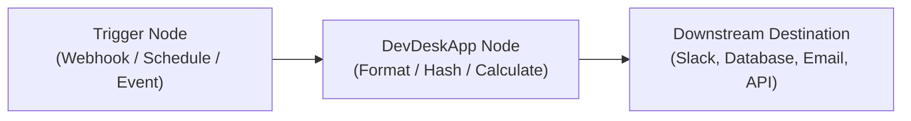

# DevDeskApp n8n Workflow Templates & Usage Guide

This guide walks you through importing and running pre-built automated workflows featuring the **DevDeskApp** n8n Community Node.

---

## 🚀 How to Import Workflows into n8n

1. Open your local n8n instance at **[http://localhost:5678/home/workflows](http://localhost:5678/home/workflows)**.
2. Click the **"..." (More options)** button on the top-right corner of the Workflows page.
3. Select **"Import from File"** (or press `Ctrl + O`).
4. Select one of the JSON files from the `templates/` folder:
   * **`templates/webhook-json-sanitizer.json`**
   * **`templates/employee-ctc-calculator.json`**
5. The complete workflow will render instantly with all node connections pre-configured!

---

## 🛠️ Supported Tools & Response Specifications

### 1. JSON Utilities (`resource: json`)

| Operation | Inputs | Sample Response Output |
| :--- | :--- | :--- |
| **Prettify** | `jsonInput`: raw string / object<br>`indentation`: `2`, `4`, or `tab` | `{ "formatted": "{\n  \"key\": \"value\"\n}", "success": true }` |
| **Minify** | `jsonInput`: formatted JSON | `{ "minified": "{\"key\":\"value\"}", "success": true }` |
| **Validate** | `jsonInput`: any JSON string | `{ "valid": true, "parsed": { "key": "value" } }`<br>*(On failure: `{ "valid": false, "error": "SyntaxError..." }` without crashing the workflow)* |

---

### 2. Crypto & Security (`resource: crypto`)

| Operation | Inputs | Sample Response Output |
| :--- | :--- | :--- |
| **Hash** | `textPayload`: string<br>`hashAlgorithm`: `md5`, `sha1`, `sha256`, `sha512` | `{ "algorithm": "sha256", "input": "...", "hash": "a591a6d40bf420404a011733cfb7b190d62c65bf0bcda32b57b277d9ad9f146e" }` |
| **Base64 Encode**| `textPayload`: raw string | `{ "encoded": "SGVsbG8gV29ybGQ=", "original": "Hello World" }` |
| **Base64 Decode**| `textPayload`: base64 string | `{ "decoded": "Hello World", "original": "SGVsbG8gV29ybGQ=" }` |
| **UUID v4** | *(None)* | `{ "uuid": "4f9d2a01-4bf1-4822-b103-6e1b7da22e11", "version": 4 }` |

---

### 3. Text & Strings (`resource: text`)

| Operation | Inputs | Sample Response Output |
| :--- | :--- | :--- |
| **Slugify String** | `textInput`: "My Blog Post Title! 123" | `{ "original": "My Blog Post Title! 123", "slug": "my-blog-post-title-123" }` |
| **Case Converter** | `textInput`: "hello world"<br>`targetCase`: `camelCase`, `kebabCase`, `snakeCase`, `pascalCase`, `upperCase`, `lowerCase` | `{ "original": "hello world", "casing": "kebabCase", "result": "hello-world" }` |

---

### 4. HR & Financial Calculator (`resource: calculator`)

| Operation | Inputs | Sample Response Output |
| :--- | :--- | :--- |
| **CTC to In-Hand** | `annualCtc`: number (e.g. `1200000`)<br>`basicPercentage`: number (default `50`) | ```json<br>{<br>  "annualCtc": 1200000,<br>  "monthlyGross": 98200,<br>  "monthlyInHand": 75600,<br>  "breakdown": {<br>    "monthlyBasic": 50000,<br>    "employeePf": 1800,<br>    "employerPf": 1800,<br>    "professionalTax": 200,<br>    "estimatedMonthlyTds": 20600<br>  },<br>  "taxRegime": "India Standard / New Tax Benchmark",<br>  "reference": "https://www.devdeskapp.com/ctc-to-in-hand-calculator"<br>}<br>``` |

---

## ⚡ Triggering DevDeskApp in Real Workflows

DevDeskApp operates as a **transformation / utility node** in n8n pipelines:



1. **Trigger:** Receive data from any event (e.g., Stripe Webhook, GitHub Event, Airtable record, or Schedule).
2. **Transform with DevDeskApp:** Clean messy JSON, sanitize strings into slugs, compute compensation splits, or sign requests with SHA-256 digests.
3. **Dispatch:** Send verified, formatted results to your CRM, Slack channel, or PostgreSQL/MySQL database.

100% of data processing occurs locally inside your n8n runner container with **zero server fees, zero token latency, and complete enterprise data privacy**.
